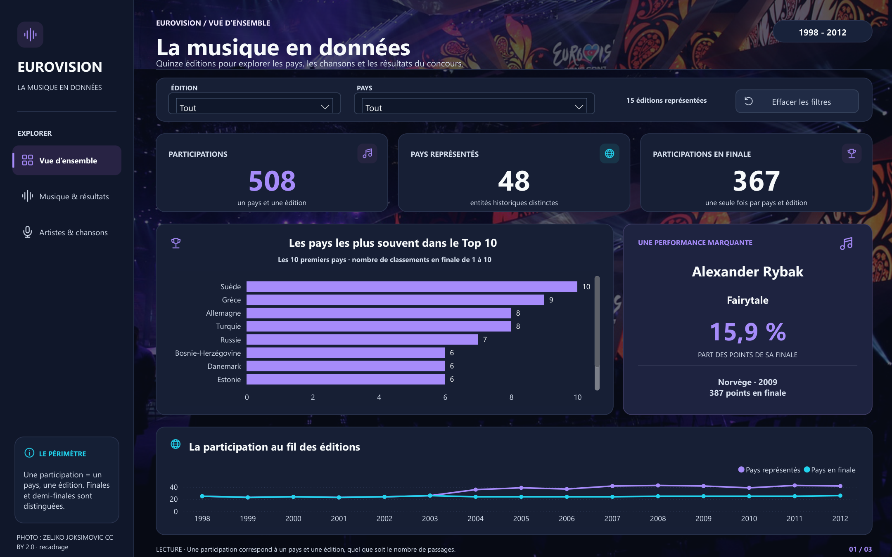
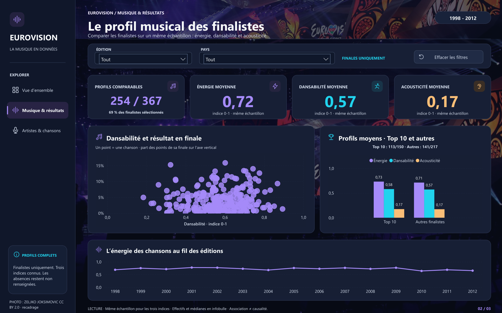
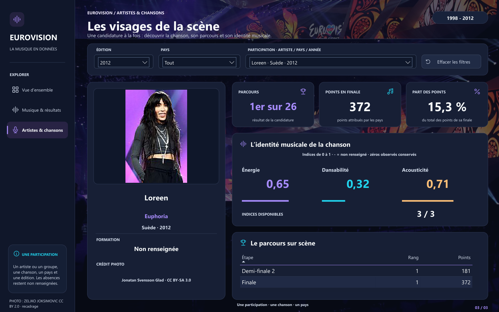

# Eurovision 1998-2012 : la musique en données

> **In English.** Power BI report on fifteen Eurovision Song Contest editions (1998-2012): participations, final rankings, voting and the musical profile of the songs, with an artist page for each of the 508 entries.
> The data are cleaned and reshaped in a Python notebook into a constellation model (three fact tables at three grains, five shared dimensions, 86 DAX measures); every correction is logged with its source.
> ENSEA group project (advanced data visualisation course), later reworked by Abdoulaye KONE.

**Power BI · DAX · Python · pandas · Modélisation en constellation**

Trois pages relient une lecture globale du concours, une analyse des caractéristiques musicales des chansons et une fiche par artiste. La préparation des données est entièrement documentée dans un notebook Python. Le rapport complet est aussi disponible [en PDF](docs/rapport_eurovision.pdf).



| Période | Pays et entités historiques | Participations | Participations en finale | Votes de finale |
| --- | ---: | ---: | ---: | ---: |
| 1998-2012, 15 éditions | 48 | 508 | 367 | 12 131 |

Une **participation** correspond à un pays et une édition. Une demi-finale et une finale sont deux **passages** de cette même participation : le modèle garde cette distinction pour éviter les doubles comptes.

## Les trois pages

| Page | Question | Contenu |
| --- | --- | --- |
| **Vue d’ensemble** | Qui participe et quels pays se distinguent ? | Participations, pays représentés, Top 10, performance marquante, évolution annuelle |
| **Musique & résultats** | Les chansons les mieux classées ont-elles un profil musical différent ? | Dansabilité et résultats, énergie, acousticité, couverture des données, Top 10 contre autres finalistes |
| **Artistes & chansons** | Quelle chanson se cache derrière les résultats ? | Portrait crédité, chanson, pays, indices musicaux et parcours par étape |

| Musique & résultats | Artistes & chansons |
| :---: | :---: |
|  |  |

## Quelques résultats

- **La Suède se classe 10 fois dans le Top 10** d’une finale sur la période, devant la Grèce (9) et l’Allemagne (8).
- **Alexander Rybak obtient 387 points en 2009**, soit **15,9 % des points distribués dans sa finale**, la part la plus élevée de la période.
- **254 des 367 finalistes disposent des trois indices musicaux** (énergie, dansabilité, acousticité), soit 69 %. Les comparaisons musicales utilisent cet échantillon commun et affichent sa couverture ; elles décrivent des écarts, pas des causes.

Les définitions, unités et dénominateurs des indicateurs figurent dans le [dictionnaire des indicateurs](reports/dictionnaire_indicateurs.csv).

## Une préparation traçable

Le notebook [traitement_donnees.ipynb](traitement_donnees.ipynb) contient tout le traitement : diagnostic, normalisation, corrections référencées, construction des clés, séparation des grains, contrôles et exports Excel. Il ne fait aucun appel au Web.

- Les codes d’absence deviennent des valeurs nulles ; les **zéros observés** sont conservés.
- Les pays et entités historiques gardent des identifiants stables.
- Participation, résultat par étape et vote sont séparés.
- Chaque correction est journalisée avec sa référence ([corrections officielles](reports/corrections_officielles.csv), [journal des transformations](reports/journal_transformations.csv)).
- Les valeurs musicales manquantes restent manquantes, **sans imputation**.

Le classeur [eurovision_constellation.xlsx](data/processed/eurovision_constellation.xlsx) contient les huit tables importées par Power BI ; le [dictionnaire du modèle](reports/dictionnaire_constellation.csv) décrit leurs champs. Une nouvelle exécution du notebook reproduit les mêmes tables et les mêmes rapports.

## Un modèle en constellation

Les données ont trois grains différents. Le modèle utilise donc **trois tables de faits et cinq dimensions partagées**, plutôt qu’une table unique mêlant participations, étapes et votes.

| Table de faits | Grain | Lignes |
| --- | --- | ---: |
| `faits_participations` | Un pays et une édition, avec les caractéristiques musicales | 508 |
| `faits_resultats` | Une participation et une étape, avec rang et points | 648 |
| `faits_votes` | Une édition, un pays donneur et une participation destinataire | 12 131 |

Les dimensions sont `dim_editions`, `dim_pays`, `dim_participations`, `dim_etapes` et `dim_pays_donneurs`. Les **11 relations** propagent les filtres des dimensions vers les faits, à sens unique ; pays donneurs et destinataires jouent des rôles distincts. Les **86 mesures DAX** sont regroupées dans la table `Mesures`.

## Ouvrir le rapport

Les données préparées sont fournies : le rapport s’ouvre sans exécuter le notebook.

1. Cloner le dépôt en conservant son organisation.
2. Ouvrir [powerbi/Eurovision_1998-2012.pbip](powerbi/Eurovision_1998-2012.pbip) dans **Power BI Desktop** (Windows).
3. Dans **Transformer les données > Gérer les paramètres**, remplacer le chemin d’exemple **DossierDonnees** (`C:\Eurovision\data\processed`) par le chemin du dossier `data/processed` de votre copie.
4. Cliquer sur **Actualiser**, puis explorer les pages avec les filtres et le menu latéral (en mode édition, maintenir **Ctrl** pour activer les boutons).

## Reproduire le traitement

Environnement de référence : Python 3.12.

```powershell
python -m venv .venv
.\.venv\Scripts\python.exe -m pip install -r requirements.txt
.\.venv\Scripts\python.exe -m jupyterlab traitement_donnees.ipynb
```

Exécuter toutes les cellules : le notebook régénère `data/processed/`, `reports/` et les figures de `assets/analysis/`, puis il suffit d’actualiser le rapport. La [galerie des participants](docs/galerie_participants.html) permet de parcourir les 508 portraits et leurs crédits après téléchargement du dépôt.

## Limites

- L’analyse couvre **1998-2012** uniquement.
- Les profils musicaux incomplets peuvent introduire un biais de sélection ; les comparaisons ne démontrent aucune causalité.
- L’unité du tempo, la formule de `Song.Quality` et la taxonomie des régions ne sont pas documentées dans la source : ces champs sont conservés pour audit mais exclus des analyses.
- La provenance éditoriale et la licence du classeur source enrichi ne sont pas renseignées.

## Images

Le fond des pages utilise une photographie de la scène de **Bakou 2012**, par **Zeljko Joksimovic**, issue de [Wikimedia Commons](https://commons.wikimedia.org/wiki/File:Baku_Crystal_Hall_-_stage_%28Eurovision_Song_Contest_2012%29_3.jpg) sous [licence CC BY 2.0](https://creativecommons.org/licenses/by/2.0/), recadrée et assombrie ([crédit détaillé](assets/backgrounds/photos/baku_2012_credit.json)).

Les portraits des 508 participations sont décrits dans le [catalogue des images](assets/artists/catalogue_images.csv) et les [crédits](reports/credits_images.csv) :

- **387 photographies sous licence libre** (Creative Commons ou domaine public), principalement de Wikimedia Commons, avec auteur, licence et lien ;
- **121 miniatures de vidéos de prestation**, utilisées faute de photo libre trouvée. Elles restent soumises aux droits de leurs ayants droit : leur présence dans le dépôt ne vaut pas autorisation de réutilisation ([liste](reports/images_droits_reserves.csv)).

## Origine du projet et licence

Projet de groupe du cours de data visualisation avancée de l’ENSEA Abidjan, repris ensuite par **Abdoulaye KONE** : préparation des données refaite et documentée, modèle en constellation, rapport Power BI redessiné, portraits crédités et remplacement de miniatures par des photos libres.

Le code et la documentation sont publiés sous [licence MIT](LICENSE). Les données sources et les images restent soumises aux droits de leurs auteurs.

---

**Abdoulaye KONE - analyste statisticien, diplômé de l’ENSEA Abidjan**
[LinkedIn](https://linkedin.com/in/abdoulaye-kone) · [GitHub](https://github.com/abdoul4Kone)
